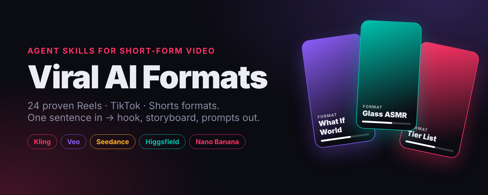
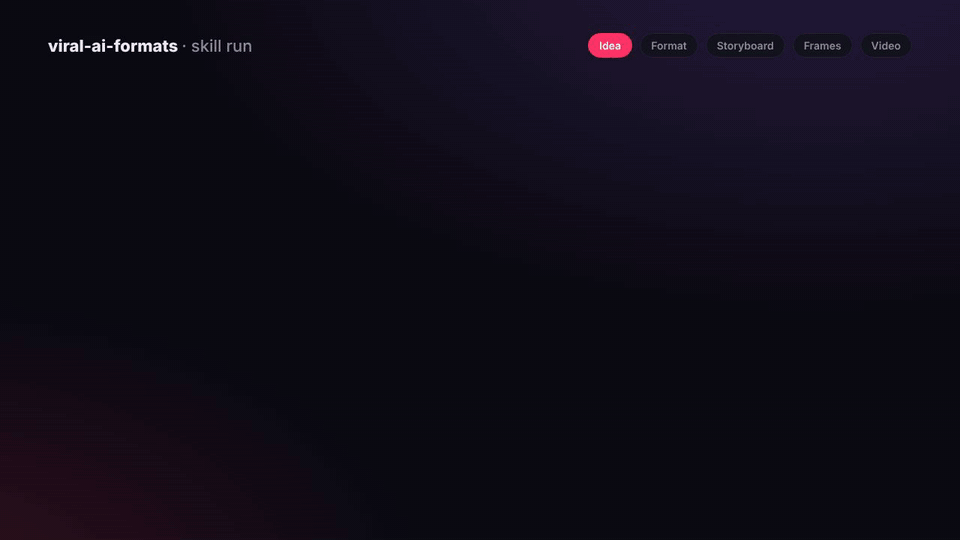

<div align="center">



# 🎬 Viral AI Formats

**24 proven short-video formats as AI agent skills.**
Turn a one-line idea into a hook, a storyboard, frame prompts and video prompts — for Reels, TikTok and YouTube Shorts.


<br><br>



</div>

---

Most AI video prompt guides teach you *how to write a prompt*.
This library teaches your AI agent **what to make** — the formats that already work on short-form platforms — and then writes every prompt for you.

```
You:    "a video about Roman food"
Agent:  → picks "How They Lived"
        → hook: "Most Romans didn't have kitchens."
        → 10 timed beats + voiceover
        → 10 storyboard frame prompts   (approve)
        → 10 image-to-video prompts     (approve)
        → captions, hashtags, sound
```

👉 **See a complete run:** [examples/what-if-world-full-run.md](examples/what-if-world-full-run.md) — one sentence in, 9 frame prompts + 9 video prompts out.

## Why this exists

- **Format first, not film first.** Existing AI-filmmaking skills are built for cinema. Short-form lives on formats: POV drops, tier lists, satisfying cuts, cliffhanger series.
- **Frames before video.** Every skill generates still storyboard frames first, then animates them. Image-to-video from a locked frame is cheaper and keeps characters consistent.
- **Built-in retention structure.** Each format has a timed beat sheet — hook in the first 2 seconds, escalation, payoff, loop or cliffhanger.
- **Model-aware.** One prompt structure, with notes for adapting to Kling, Veo, Seedance, Higgsfield, Nano Banana and others.
- **Honest by default.** No fake testimonials, no real-person deepfakes, AI disclosure where it matters.

## The formats

| | Format | What it makes |
|---|---|---|
| 🧭 | [format-picker](skills/format-picker) | Picks the best 3 formats for your idea |
| **Stories & POV** | | |
| 🌀 | [what-if-world](skills/what-if-world) | "What if you woke up in…" — viewer dropped into another world |
| 🏺 | [how-they-lived](skills/how-they-lived) | Everyday life in past eras, narrated |
| ⏰ | [day-in-the-life](skills/day-in-the-life) | A whole day of an unusual job or era in 40 s |
| 👁️ | [pov-object](skills/pov-object) | "POV: you're a coin / a sock / the last fry" |
| 🕯️ | [horror-narration](skills/horror-narration) | Rules-horror and creepy stories, dread not gore |
| 🏙️ | [time-evolution](skills/time-evolution) | Same spot from 1000 BC to 3000 AD |
| 🎭 | [micro-drama](skills/micro-drama) | Cliffhanger soap-opera series, Part 1, 2, 3… |
| **Characters & comedy** | | |
| 🤖 | [silent-cartoon-gag](skills/silent-cartoon-gag) | Dialogue-free slapstick, works in every language |
| 🥚 | [objects-alive](skills/objects-alive) | What your fridge does when you leave |
| 🐱 | [animal-job](skills/animal-job) | Deadpan animals in human jobs |
| 👶 | [ai-baby-dance](skills/ai-baby-dance) | Stylized baby dance trend, loopable |
| **Learn** | | |
| 🏆 | [tier-list](skills/tier-list) | S-to-F rankings that start debates |
| 🌍 | [what-happens-if](skills/what-happens-if) | Science hypotheticals with a timeline |
| 📏 | [scale-comparison](skills/scale-comparison) | You vs. the biggest things ever |
| 🐉 | [myth-explained](skills/myth-explained) | Myths and legends in 60 seconds |
| **Ads** | | |
| 🍣 | [product-alive](skills/product-alive) | The product becomes a living character |
| 💎 | [product-hero](skills/product-hero) | Premium splash / levitation / orbit commercial |
| 🎙️ | [ai-presenter](skills/ai-presenter) | Original AI host explains to camera (disclosed) |
| **Visual & edit** | | |
| 🔁 | [infinite-zoom](skills/infinite-zoom) | Endless nested zoom, seamless loop |
| 🦋 | [transformation-morph](skills/transformation-morph) | Sketch → photo, era → era, raw → finished |
| ⚡ | [dopamine-edit](skills/dopamine-edit) | Beat-synced fast-cut aesthetic edits |
| 🎵 | [ai-music-video](skills/ai-music-video) | Visuals synced to your own song |
| 🏗️ | [miniature-world](skills/miniature-world) | Tiny workers, giant objects, tilt-shift |
| 🔪 | [asmr-satisfying](skills/asmr-satisfying) | Cutting glass fruit and other impossible things |

## Install

### Claude.ai (web or mobile) — no code
1. Open the [`dist/`](dist) folder and download the `.zip` of the format you want. Start with `format-picker.zip` plus 2–3 formats.
2. In Claude: **Customize → Skills → + → Upload a skill**, choose the zip. Repeat for each format.
3. Just ask: *"Make a what-if video about a world where it's always night."*

`viral-ai-formats-all.zip` contains every skill folder at once — for agents where you copy folders manually.

### Claude Code
```bash
/plugin marketplace add babaevvagab924-creator/-viral-ai-formats
/plugin install viral-ai-formats@viral-ai-formats
```

### Any agent that reads SKILL.md (Codex, OpenCode, Cursor, etc.)
```bash
npx skills add babaevvagab924-creator/-viral-ai-formats
```
Or copy any folder from `skills/` into your agent's skills directory.

## How every skill works

1. **Concept** — hook line, timed beat sheet, character descriptor. *You approve.*
2. **Frame prompts** — one still image per beat, same locked descriptor every time. *You approve.*
3. **Video prompts** — one image-to-video prompt per approved frame, one action per clip.
4. **Packaging** — on-screen text, caption, hashtags, sound notes.

Each skill ships with `references/models.md`: a cheatsheet for adapting prompts to each image and video model, plus a character-consistency kit.

## Gallery

> Made something with these skills? [Submit it here](../../issues/new?template=gallery.yml) — the best ones get featured in this README.
>
> Know a format that keeps going viral? [Suggest it](../../issues/new?template=new-format.yml).

<!-- Add GIFs here:  -->

## Contributing

New formats are the heart of this repo. See [CONTRIBUTING.md](CONTRIBUTING.md) — one folder, one `SKILL.md`, follow the template.

## License

MIT — use these skills for personal and commercial work.

If this saves you time, a ⭐ helps other creators find it.
